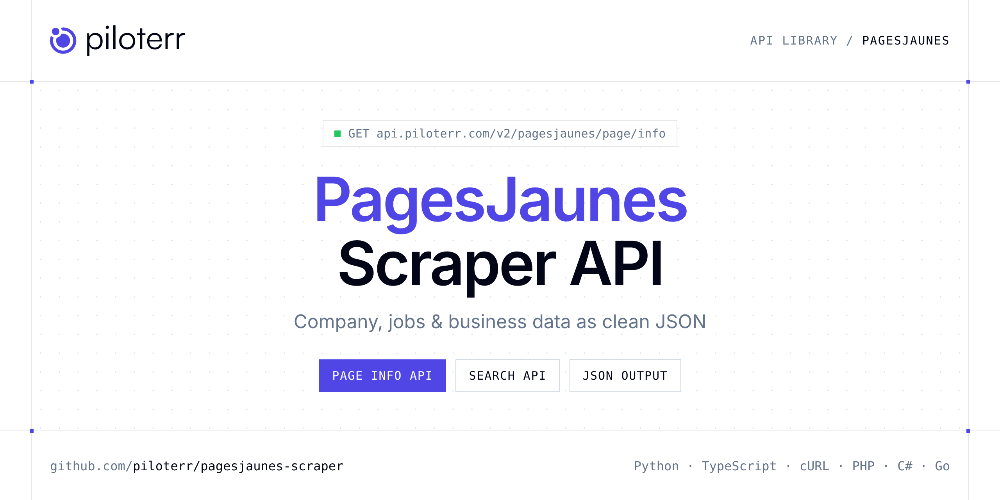

<p align="center">
  <a href="https://www.piloterr.com"></a>
</p>

# PagesJaunes Scraper API

[](https://discord.gg/CFj3ph8aHU) [](https://app.piloterr.com) [](https://app.piloterr.com/openapi) [](LICENSE)

The **Piloterr PagesJaunes Scraper API** lets you extract public data from PagesJaunes as **clean, structured JSON** — no proxies, headless browsers or HTML parsing to maintain. Endpoints available in production:

- **PagesJaunes Page Info API** — Retrieve detailed business information from a PagesJaunes page, including contact details, opening hours, services, payment methods, and SIREN number.
- **PagesJaunes Search API** — Search PagesJaunes for French local businesses by category and location, returning paginated results with contact details and ratings.

Use it for lead generation, CRM enrichment, market mapping, investment research or job market analytics.

| Endpoint | Path | Credits | What you get |
|---|---|---|---|
| [PagesJaunes Page Info API](#pagesjaunes-page-info-api) | `/v2/pagesjaunes/page/info` | 1 | Retrieve detailed business information from a PagesJaunes page, including contact details, opening hours, services, payment methods, and SIREN number. |
| [PagesJaunes Search API](#pagesjaunes-search-api) | `/v2/pagesjaunes/search` | 1 | Search PagesJaunes for French local businesses by category and location, returning paginated results with contact details and ratings. |

## Table of contents

- [How it works](#how-it-works)
- [PagesJaunes Page Info API](#pagesjaunes-page-info-api)
- [PagesJaunes Search API](#pagesjaunes-search-api)
- [Code examples in other languages](#code-examples-in-other-languages)
- [Practical use cases](#practical-use-cases)
- [Why Piloterr?](#why-piloterr)
- [FAQ](#faq)
- [Official SDKs](#official-sdks)
- [Related scrapers](#related-scrapers)
- [Support](#support)

## How it works

1. **Create a free Piloterr account** and copy your API key from the [dashboard](https://app.piloterr.com).
2. **Send a `GET` (or `POST`) request** to `https://api.piloterr.com/v2/...` with the header `x-api-key: YOUR_API_KEY`.
3. **Receive structured JSON** — Piloterr handles rendering, proxies, retries and parsing.

```bash
export PILOTERR_API_KEY="your-api-key"
pip install requests        # Python
# TypeScript: Node.js 18+ (native fetch), run with `npx tsx file.ts`
```

> Every endpoint accepts both `GET` (query string) and `POST` (JSON body with the same fields).

## PagesJaunes Page Info API

Retrieve detailed business information from a PagesJaunes page, including contact details, opening hours, services, payment methods, and SIREN number.

`GET | POST https://api.piloterr.com/v2/pagesjaunes/page/info` · **1 credit per request** · [Full reference](https://app.piloterr.com/openapi)

### Request parameters

| Parameter | Type | Required | Description |
|---|---|---|---|
| `query` | string | ✅ | A PagesJaunes business page URL or business ID. |

### Python example

```python
import json
import os
import requests

response = requests.get(
    "https://api.piloterr.com/v2/pagesjaunes/page/info",
    headers={"x-api-key": os.environ["PILOTERR_API_KEY"]},
    params={
        "query": "https://www.pagesjaunes.fr/pros/56824689",
    },
    timeout=120,
)
response.raise_for_status()
data = response.json()

print(json.dumps(data, indent=2, ensure_ascii=False)[:2000])
```

### TypeScript example

```typescript
type PagesjaunesPageInfo = {
  url?: string;
  name?: string;
  phone?: string;
  address?: string;
  activity?: string;
  services?: string[];
  websites?: {
    url?: string;
    type?: string;
  }[];
  business_info?: {
    siren?: string;
    forme_juridique?: string;
    effectif_entreprise?: string;
    creation_d_entreprise?: string;
  };
  opening_hours?: {
    day?: string;
    hours?: string;
  }[];
  payment_methods?: string[];
};

const params = new URLSearchParams({
  "query": "https://www.pagesjaunes.fr/pros/56824689",
});

const response = await fetch(`https://api.piloterr.com/v2/pagesjaunes/page/info?${params}`, {
  headers: { "x-api-key": process.env.PILOTERR_API_KEY! },
});
if (!response.ok) throw new Error(`Piloterr error ${response.status}: ${await response.text()}`);

const data = (await response.json()) as PagesjaunesPageInfo;

console.log(JSON.stringify(data, null, 2).slice(0, 2000));
```

<details>
<summary><b>POST variant</b></summary>

```http
POST https://api.piloterr.com/v2/pagesjaunes/page/info
x-api-key: YOUR_API_KEY
Content-Type: application/json

{"query": "https://www.pagesjaunes.fr/pros/56824689"}
```
</details>

### Output example

Example response from the API reference, abridged — real values depend on the page you scrape.

```json
{
  "url": "https://www.pagesjaunes.fr/pros/56824689",
  "name": "Agustin Mayo",
  "phone": "example",
  "address": "13 place Lafourcade 31400 Toulouse",
  "activity": "Chirurgien-dentiste",
  "services": [
    "détartrage dentaire",
    "radiologie dentaire"
  ],
  "websites": [
    {
      "url": "https://www.facebook.com/dentistetoulouse/",
      "type": "facebook"
    },
    {
      "url": "https://www.docteurmayo.fr",
      "type": "website"
    }
  ],
  "business_info": {
    "siren": "839625662",
    "forme_juridique": "5785",
    "effectif_entreprise": "3 à 5 salariés",
    "creation_d_entreprise": "2 janvier 2018"
  },
  "opening_hours": [
    {
      "day": "Lundi",
      "hours": "09h00 - 18h00"
    },
    {
      "day": "Mardi",
      "hours": "09h00 - 18h00"
    }
  ],
  "payment_methods": [
    "Espèces",
    "Visa"
  ]
}
```

### Response fields

| Field | Type | Description |
|---|---|---|
| `url` | string |  |
| `name` | string |  |
| `phone` | string |  |
| `address` | string |  |
| `activity` | string |  |
| `services` | string[] |  |
| `websites[]` | object[] |  |
| `websites[].url` | string |  |
| `websites[].type` | string |  |
| `business_info` | object |  |
| `business_info.siren` | string |  |
| `business_info.forme_juridique` | string |  |
| `business_info.effectif_entreprise` | string |  |
| `business_info.creation_d_entreprise` | string |  |
| `opening_hours[]` | object[] |  |
| `opening_hours[].day` | string |  |
| `opening_hours[].hours` | string |  |
| `payment_methods` | string[] |  |

## PagesJaunes Search API

Search PagesJaunes for French local businesses by category and location, returning paginated results with contact details and ratings.

`GET | POST https://api.piloterr.com/v2/pagesjaunes/search` · **1 credit per request** · [Full reference](https://app.piloterr.com/openapi)

### Request parameters

| Parameter | Type | Required | Description |
|---|---|---|---|
| `query` | string | ✅ | A valid PagesJaunes search URL. |

### Python example

```python
import json
import os
import requests

response = requests.get(
    "https://api.piloterr.com/v2/pagesjaunes/search",
    headers={"x-api-key": os.environ["PILOTERR_API_KEY"]},
    params={
        "query": "https://www.pagesjaunes.fr/annuaire/chercherlespros?quoiqui=Dentiste&ou=Toulouse+(31000)&univers=pagesjaunes&idOu=",
    },
    timeout=120,
)
response.raise_for_status()
data = response.json()

print(json.dumps(data, indent=2, ensure_ascii=False)[:2000])
```

### TypeScript example

```typescript
type PagesjaunesSearch = {
  results?: {
    id?: string;
    url?: string;
    name?: string;
    tags?: string[];
    address?: string;
    activity?: string;
    image_url?: string;
  }[];
  pagination?: {
    next?: number;
    current?: number;
    other_pages?: number[];
    total_pages?: number;
    has_next_page?: boolean;
  };
};

const params = new URLSearchParams({
  "query": "https://www.pagesjaunes.fr/annuaire/chercherlespros?quoiqui=Dentiste&ou=Toulouse+(31000)&univers=pagesjaunes&idOu=",
});

const response = await fetch(`https://api.piloterr.com/v2/pagesjaunes/search?${params}`, {
  headers: { "x-api-key": process.env.PILOTERR_API_KEY! },
});
if (!response.ok) throw new Error(`Piloterr error ${response.status}: ${await response.text()}`);

const data = (await response.json()) as PagesjaunesSearch;

console.log(JSON.stringify(data, null, 2).slice(0, 2000));
```

<details>
<summary><b>POST variant</b></summary>

```http
POST https://api.piloterr.com/v2/pagesjaunes/search
x-api-key: YOUR_API_KEY
Content-Type: application/json

{"query": "https://www.pagesjaunes.fr/annuaire/chercherlespros?quoiqui=Dentiste&ou=Toulouse+(31000)&univers=pagesjaunes&idOu="}
```
</details>

### Output example

Example response from the API reference, abridged — real values depend on the page you scrape.

```json
{
  "results": [
    {
      "id": "56824689",
      "url": "https://www.pagesjaunes.fr/pros/56824689",
      "name": "Agustin Mayo",
      "tags": [
        "détartrage dentaire",
        "radiologie dentaire"
      ],
      "address": "13 place Lafourcade 31400 Toulouse",
      "activity": "Chirurgien-dentiste",
      "image_url": "https://www.pagesjaunes.fr/media/newdam/preset-thumbnail-lr-health/5c/33/7e/00/00/f0/04/18/50/c1/5d415c337e0000f0041850c1/5d415c337e0000f…"
    },
    {
      "id": "62118760",
      "url": "https://www.pagesjaunes.fr/pros/62118760",
      "name": "Association Centre de Santé Toulouse Bayard",
      "tags": [
        "soin bucco-dentaire",
        "chirurgie dentaire"
      ],
      "address": "43 rue Bayard 31000 Toulouse",
      "activity": "Centre dentaire"
    }
  ],
  "pagination": {
    "next": 2,
    "current": 1,
    "other_pages": [
      2,
      3
    ],
    "total_pages": 37,
    "has_next_page": true
  }
}
```

### Response fields

| Field | Type | Description |
|---|---|---|
| `results[]` | object[] |  |
| `results[].id` | string |  |
| `results[].url` | string |  |
| `results[].name` | string |  |
| `results[].tags` | string[] |  |
| `results[].address` | string |  |
| `results[].activity` | string |  |
| `results[].image_url` | string |  |
| `pagination` | object |  |
| `pagination.next` | integer |  |
| `pagination.current` | integer |  |
| `pagination.other_pages` | integer[] |  |
| `pagination.total_pages` | integer |  |
| `pagination.has_next_page` | boolean |  |

## Code examples in other languages

Ready-to-run examples live in the [`examples/`](examples) folder. Each one reads your key from the `PILOTERR_API_KEY` environment variable.

| Language | Page Info | Search |
|---|---|---|
| cURL (Bash) | [`page-info`](examples/curl/page_info.sh) | [`search`](examples/curl/search.sh) |
| PHP | [`page-info`](examples/php/page_info.php) | [`search`](examples/php/search.php) |
| C# | [`page-info`](examples/csharp/PageInfo.cs) | [`search`](examples/csharp/Search.cs) |
| Go | [`page-info`](examples/go/page_info.go) | [`search`](examples/go/search.go) |
| Java | [`page-info`](examples/java/PageInfoExample.java) | [`search`](examples/java/SearchExample.java) |
| Ruby | [`page-info`](examples/ruby/page_info.rb) | [`search`](examples/ruby/search.rb) |
| Node.js | [`page-info`](examples/nodejs/page_info.mjs) | [`search`](examples/nodejs/search.mjs) |

## Practical use cases

- **Lead generation** — Build target account lists from public company data.
- **CRM enrichment** — Keep firmographics, websites and descriptions up to date.
- **Market mapping** — Map competitors and segments across countries and industries.
- **Investment research** — Screen companies, funding and signals for deal flow.
- **Job market analytics** — Track hiring, roles and salaries where available.

## Why Piloterr?

- **No infrastructure** — no proxies, headless browsers or CAPTCHA solving to run yourself.
- **Structured JSON** — stable, documented fields instead of brittle HTML selectors.
- **Pay per request** — transparent credit cost per endpoint, failed requests are retried for you.
- **One API key, hundreds of sources** — PagesJaunes plus many other e-commerce, search and company data endpoints in the [Piloterr library](https://www.piloterr.com/library).
- **Any language** — plain HTTPS + JSON, with examples for Python, TypeScript, cURL, PHP, C#, Go, Java, Ruby and Node.js.

## FAQ

### Is it legal to scrape PagesJaunes?

Collecting publicly available data is generally allowed in many jurisdictions, but rules depend on your country, the data you collect and how you use it. Avoid personal data unless you have a lawful basis, respect the website's terms where they apply, and get legal advice for your specific use case. This is not legal advice.

### Do I need proxies or a headless browser?

No. Piloterr handles rendering, proxy rotation and retries on its side. You only send an HTTPS request with your `x-api-key` header and receive JSON.

### How much does a request cost?

Credits per call: `/v2/pagesjaunes/page/info` **1**, `/v2/pagesjaunes/search` **1**. See the [Piloterr website](https://www.piloterr.com) for plans.

### What data does the PagesJaunes API return?

Each endpoint returns structured JSON: **PagesJaunes Page Info** — `url`, `name`, `phone`, `address`, `activity`, `services`; **PagesJaunes Search** — `results[]`, `results[].id`, `results[].url`, `results[].name`, `results[].tags`, `results[].address`.

### Which languages are supported?

Any language that can make an HTTP request. This README shows Python and TypeScript; the [`examples/`](examples) folder contains cURL, PHP, C#, Go, Java, Ruby and Node.js.

## Official SDKs

Use Piloterr from your own language with a typed client:

| SDK | Package | Install |
| --- | --- | --- |
| Node.js | [`@piloterr/sdk`](https://www.npmjs.com/package/@piloterr/sdk) | `npm install @piloterr/sdk` |
| Python | [`piloterr`](https://pypi.org/project/piloterr/) | `pip install piloterr` |
| Go | [`piloterr-go`](https://pkg.go.dev/github.com/piloterr/piloterr-go) | `go get github.com/piloterr/piloterr-go` |
| .NET | [`Piloterr`](https://www.nuget.org/packages/Piloterr) | `dotnet add package Piloterr` |
| Ruby | [`piloterr`](https://rubygems.org/gems/piloterr) | `gem install piloterr` |
| PHP | [`piloterr/sdk`](https://packagist.org/packages/piloterr/sdk) | `composer require piloterr/sdk` |
| Java | [`piloterr-java`](https://github.com/piloterr/piloterr-java) | build from source, see its README |
| CLI | [`@piloterr/cli`](https://www.npmjs.com/package/@piloterr/cli) | `npm install -g @piloterr/cli` |
| MCP server | [`@piloterr/mcp`](https://www.npmjs.com/package/@piloterr/mcp) | `npx -y @piloterr/mcp` |

## Related scrapers

- [Company Database Scraper API](https://github.com/piloterr/company-data-api)
- [Crunchbase Scraper API](https://github.com/piloterr/crunchbase-scraper)
- [Europages Scraper API](https://github.com/piloterr/europages-scraper)
- [Fiverr Scraper API](https://github.com/piloterr/fiverr-scraper)
- [G2 Scraper API](https://github.com/piloterr/g2-scraper)
- [GitHub Scraper API](https://github.com/piloterr/github-scraper)
- [All Piloterr scrapers on GitHub](https://github.com/piloterr)

## Support

- 💬 Join the [Piloterr Discord](https://discord.gg/CFj3ph8aHU) to ask questions and share what you build.
- 📚 Browse the [API reference (OpenAPI)](https://app.piloterr.com/openapi) and the [Piloterr library](https://www.piloterr.com/library).
- 🔑 [Get your API key](https://app.piloterr.com).

---

<p align="center">
  <a href="https://www.piloterr.com">
    <picture>
      <source media="(prefers-color-scheme: dark)" srcset="images/logo-dark.svg">
      
    </picture>
  </a>
  <br>
  <sub>Built by <a href="https://www.piloterr.com">Piloterr</a> — web scraping APIs for e-commerce, search, real estate and more, one API key.</sub>
</p>

<sub>PagesJaunes is a trademark of its respective owner. This repository is not affiliated with or endorsed by PagesJaunes. Examples are released under the MIT license.</sub>
